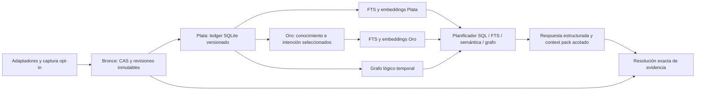

# Arquitectura elegida

## Núcleo y flujo

Un archivo local contiene `archive.json`, `ledger.sqlite`, `bronze/objects/`, `bronze/sources/`, `revisions/`, `projections/` y `jobs/`. Un `archive_id` UUID y `access_domain_id` UUID se crean al inicializar; no se derivan de una ruta. Plata y Oro son tablas/vistas del mismo archivo. Los objetos pesados idénticos se comparten dentro del dominio de acceso. No se crea una base por proyecto. Una separación de permisos entre usuarios requiere archivos distintos: un filtro de proyecto no es aislamiento de seguridad. No hay acceso multiusuario remoto en esta release.

El núcleo embebido ejecuta adquisición, parser, índices, transacciones y validación. La skill instruye cuándo abrir evidencia y cómo reconciliar estado actual antes de continuar. No delega al embedding model la clasificación de verdad, permisos, recuentos o cierre. Un módulo de extracción determinista produce candidatos; una revisión explícita puede seleccionar y corregir esos candidatos, preservando la evidencia del acto de revisión. No se necesita un LLM remoto para ninguna operación del motor.

## ADR-01: evolución compatible

Se añaden `archive`, `context`, `stats`, `intent`, `serve`, `bundle` y `capture` al CLI. `audit`, `query`, `show`, `evidence`, `graph`, `semantic-index`, `verify-case`, `verify-projection` y `hydrate` siguen aceptando casos viejos sin reescribirlos. Se corrigen defectos de normalización en capturas **nuevas**, manteniendo rutas/argumentos/respuestas legadas; los nuevos campos son aditivos. Los fixes de intención y ocurrencias llegan al `audit` existente además de al archivo nuevo; por eso los probes de 0.3.0 deben volverse GREEN.

`archive import-case` lee casos 0.1/0.2/0.3, copia o reutiliza bytes bajo el nuevo archivo y construye `legacy_alias(case_hash, old_event_id, logical_event_id)` y fuentes virtuales para sus URIs. No hay migración in-place. La tabla de versiones no intenta fingir que el caso viejo tenía mejor normalización. Lectura de un caso viejo conserva su reporte original y advierte sus límites conocidos; la normalización corregida es otra proyección con su identidad y versión.

## ADR-02: identidad antes de optimización

Una sesión se identifica por harness + dominio de origen + ID nativo. Para compatibilidad, `ses:codex:<native>` permanece como alias público de un caso que solo contiene un dominio; una ambigüedad de dominios exige el ID completo. Un actor primario se enlaza a su sesión, no a un actor global que mezcle autores. `session_id` compartido y `parent_thread_id` forman agrupación/lineage; nunca sustituyen `payload.id` nativo. No se inventa un UUID nativo cuando falta: se crea una identidad local provisional con `identity_status=UNCERTAIN` y se conserva la procedencia.

Un ID nativo de item/call se cualifica por sesión, turn/epoch y tipo. La función exacta se especifica en DATA-CONTRACT. El hash de contenido sirve para compartir bytes, no para inferir que hubo un único acto. El fingerprint de comando agrupa ocurrencias para estadísticas; no correlaciona resultados ni revoca fallos.

## ADR-03: snapshots lógicos, chunks físicos

Bronce divide bytes de origen en bloques de 4 MiB, conservando sin cambios todos los bytes, CRLF, UTF-8 y registros malformados. Un manifiesto de fuente ordena objetos por digest, offset y tamaño. Para fuentes comprimidas conserva el archivo comprimido original y un manifiesto decodificado para rangos de registros; son representaciones explícitas, no una sustitución silenciosa. Se usa gzip determinista opcional para objetos; codec y hash de bytes sin comprimir forman el contrato. Zstandard sigue disponible solo en runtimes que lo soportan y nunca es requisito para abrir un gzip/plain.

La captura fija el límite de bytes al comenzar y verifica el prefijo nuevamente antes del commit. Una actualización de un archivo arbitrario **lee el prefijo para verificarlo**: no se promete IO sublineal. Reutiliza parseo de prefijo comprobado, ocurrencias y embeddings; normalización e inferencia cuestan el delta más invalidaciones dependientes. Una escritura del prefijo crea una revisión divergente, no sobrescribe fuentes previas. Sin prueba de continuidad no se une por similitud.

La cuenta de corpus y manifiestos crece por referencias ligeras; no se clona tres veces el payload. FTS, graph adjacency y sidecars son reconstruibles. Se rechaza introducir Neo4j, un servidor vectorial o copiar todo por proyecto: no resuelven los defectos observados ni los límites de acceso locales.

## ADR-04: revisión temporal append-only

Cada cambio de afirmación, pertenencia, relación, promoción o intención añade una revisión. `commit_seq` ordena conocimiento y `recorded_at` permite consultas de corte temporal; `valid_from/to` describen vigencia. Los eventos y ejecuciones tienen sus propios tiempos puntuales/duraciones. Los tiempos no se intercambian. Las correcciones retrospectivas permiten recuperar tanto “qué creemos ahora sobre aquel día” como “qué conocíamos aquel día”. Todas las aristas y los índices tienen filtros temporales/ámbito antes de ranking y recorrido.

## ADR-05: contexto compuesto y autoridad limitada

Oro expone dos vistas separadas: `project_knowledge` y `task_intent_state`. Un pack siempre identifica el proyecto y la tarea efectivos, la misión del programa, la versión de encargo y los huecos. Una petición incidental añade una subtarea y conserva la misión. Una revisión humana directa o transmitida puede sustituir el encargo, pero debe nombrar o resolver exactamente su destinatario y conservar toda la cadena de procedencia. Una cita de un agente sin origen humano resoluble es un candidato atribuido, no autoridad humana.

El planificador devuelve hechos estructurados y evidencia; el render determinista produce prosa/Markdown sin fabricar una respuesta LLM. La evaluación de continuación sí usa agentes nuevos con una tarea real controlada. Esos trials y el gold set sintético miden cosas distintas.

## ADR-06: residencia opcional y aislamiento

Un proceso `serve` mantiene solo readers, modelos y consultas. Se accede mediante named pipe de usuario en Windows o socket Unix 0600. Comparte las mismas funciones exportadas; no implementa un segundo ranking. No escribe archivo, no inicia captura/indexación ni acepta SQL arbitrario. Una publicación de proyección usa un nuevo handle verificado; una consulta ya iniciada termina sobre la generación anterior. No hay bind HTTP, MCP obligatorio ni instalación de servicio del sistema.

## Integración y coste de la decisión

### Ownership conceptual y dependencias

| Componente | Interfaces públicas | Efectos permitidos y dependencias |
|---|---|---|
| Adaptadores | normalize/inspect hacia ingesta | Leer formato y producir candidatos con refs; no promover autoridad, ejecutar histórico ni requerir modelo remoto. Dependen de tipos/utilidades, nunca de reader/residente. |
| Archive writer | archive.init/ingest/import_case/recover, association.record | Único propietario de commits/CAS/checkpoints; usa adapters y ledger. No llama al servidor residente. |
| Ledger/temporal | select visible assertion revisions, resolve refs | Selector compartido de tiempo/ámbito; no incorpora ranking o permisos humanos derivados de texto. |
| Context writer | intent.extract/review, gold.promote/revise | Añadir revisiones bajo el mismo writer; depende del ledger/evidencia. No sustituye el significado de instrucciones por scores. |
| Semantic builder | semantic.build/verify | Escribir staging/sidecar verificado bajo lock; depende de ledger y proveedor local. No modificar Bronce. |
| Reader/planner | query/stats/context.build/event.show/graph/evidence | Solo lectura de snapshot; depende del selector, evidencia e índices. No mutar, publicar, indexar ni capturar. |
| Resident | handshake/query/status/stop | Mantener handles/modelos; invocar el mismo reader sin ranking alternativo. No importar módulos writer ni aceptar mutaciones. |
| Bundle/capture | bundle.export/import, capture.init/append/status | Transporte/spool privados con límites; importación publica a través de archive writer. No acceso a otros proyectos ni replay histórico. |
| CLI/skill | flags/RPC y procedimiento de agente | CLI despacha a interfaces; skill verifica evidencia y contexto actual. No es una segunda implementación del núcleo. |

Dependencias nuevas no pueden formar ciclos reader→writer→reader ni resident→writer. Los módulos de schema/utilidades son hojas compartidas. Los architecture tests enumerarán archivos NUEVOS reales y edges import estáticos/dinámicos literales; imports dinámicos no resolubles deben declararse y revisarse, no ignorarse. Con cero módulos nuevos el resultado es NOT_IMPLEMENTED, nunca PASS vacío. El ciclo legado dinámico semantic→integrity→semantic se registra como baseline y no exige refactor cosmético en esta fase. Una dependencia nueva que lo amplíe requiere justificación y review específica.

Las raíces existentes `src/adapters.js`, `audit.js`, `reducers.js`, `database.js`, `retrieval.js`, `graph.js`, `semantic.js`, `render.js` siguen aportando lógica válida. Nuevos módulos bajo `src/archive/`, `src/context/`, `src/resident/`, `src/bundle/`, `src/capture/` separan responsabilidades; el implementador puede subdividir archivos sin cambiar contratos. No puede sustituir el producto por dos plataformas. El write set por cambio fija qué áreas toca, y todo cambio al contrato exige revisión antes de continuar el código dependiente.
