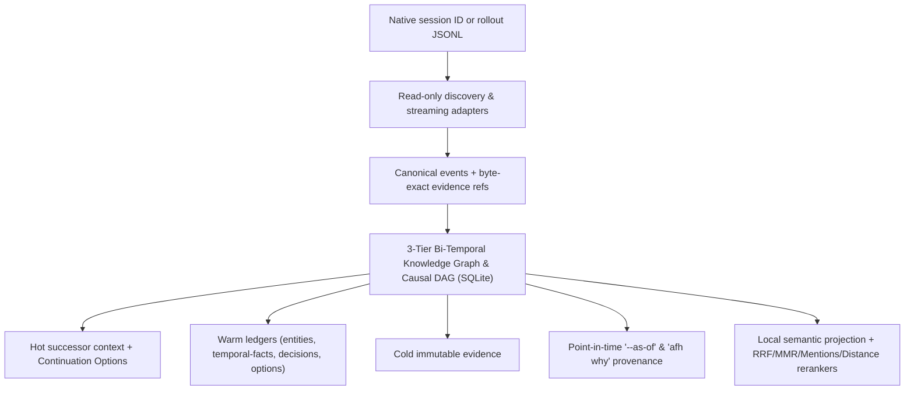

# Agent Forensic Handoff

[](https://github.com/Balthurk/agent-forensic-handoff/actions/workflows/ci.yml)
[](LICENSE)

Evidence-backed forensic reconstruction, bi-temporal knowledge graph, multi-parent causal DAG, point-in-time epistemic time travel, and continuation option synthesis for historical agent sessions.

Agent Forensic Handoff (`afh`) turns persisted session evidence into a deterministic case: a normalized timeline, actor and tool ledgers, artifact provenance, a 3-tier bi-temporal knowledge graph (`event` + `entity_node` + `temporal_fact`), a multi-parent causal DAG, point-in-time state reconstruction (`vigente` vs `stale`), a continuation option composer, and byte-exact resolvable links back to the original records. Optional local embeddings add multilingual semantic and hybrid retrieval with Graphiti-inspired rerankers (`rrf`, `mmr`, `mentions`, `node-distance`) without making vector similarity an authority.

It is deliberately **not** a chat summarizer. It never claims to recover events a harness did not persist.

## What it does

Given a native session ID or transcript path, `afh`:

- discovers Codex, Claude Code, Antigravity, or generic JSONL evidence;
- streams plain, gzip, and Zstandard sources without placing the transcript in one prompt;
- preserves every source record, including invalid or unsupported records;
- extracts exhaustive Codex rollout records: visible model reasoning (`response_item/reasoning`, `event_msg/agent_reasoning`, `item_completed.Reasoning`), `apply_patch` unified diffs (`*** Begin Patch` / `Add File` / `Update File` / `Delete File` / `Move to`), `exec_command` / `write_stdin` envelopes (`Chunk ID`, `Wall time`, `Process exited with code`), plans (`item_completed.Plan`), code reviews (`entered_review_mode` / `exited_review_mode`), rollbacks (`thread_rolled_back` `num_turns`), turn aborts (`turn_aborted`), goal updates (`thread_goal_updated`), world state (`world_state`), dynamic tools (`DynamicToolCall`), hooks (`HookPrompt`), MCP calls, and subagent delegation;
- constructs a **3-tier Bi-Temporal Knowledge Graph** (inspired by Zep's `Graphiti`, `arXiv:2501.13956`):
  - **Episodic Subgraph (`event`, `event_edge`, `session_edge`):** Multi-parent Causal DAG (`CauseTrace` fan-out / fan-in) with `CAUSED_BY_USER`, `MOTIVATED_BY_REASONING`, `CONSUMED_OBSERVATION`, `TRIGGERED_RECOVERY`, `RESULT_OF`, `ROLLED_BACK_BY`, and `ABORTED_BY` edges;
  - **Semantic Entity Subgraph (`entity_node`, `entity_mention`, `entity_fts`):** Canonicalized `ARTIFACT`, `COMMAND`, `USER_INTENT`, `CONSTRAINT`, `DESIGN_CONCEPT`, `SYMBOL`, and `ERROR_SYMPTOM` nodes;
  - **Bi-Temporal Fact Ledger (`temporal_fact`, `fact_fts`):** 4-timestamp bi-temporal bounds (`valid_at`, `invalid_at`, `created_at`, `expired_at`) plus deterministic ordinal coordinates (`valid_from_ordinal`, `invalid_at_ordinal`) distinguishing `VIGENTE` facts from `STALE`, `SUPERSEDED`, `ROLLED_BACK`, `INVALIDATED_BY_FAILURE`, and `CONTRADICTED` facts;
- reconstructs **point-in-time epistemic context** (`--as-of <ISO_TIME|ORDINAL>` and `afh why <id>`), showing what was empirically known (`DIRECT_EVIDENCE` / `CORROBORATED`) versus inferred (`INFERRED` visible reasoning) when a decision or edit was made;
- synthesizes ranked **Continuation Options** (`afh options` / `continuation_option` table) and explicit dead-end guardrails (`GUARDRAIL_AVOID_DEAD_ENDS`) grounded in active constraints, pending plans, stale validations, and prior failures;
- generates hot, warm, and cold context so a successor agent can continue safely without ingesting the full transcript.



## Install

Requirements: Node.js 18, 20, or 22+ (uses native `node:sqlite` on Node 22.15+ and a built-in synchronous worker bridge fallback on Node 18/20).

```bash
npm install -g github:Balthurk/agent-forensic-handoff
afh doctor
```

Install the bundled Agent Skill globally for your harness:

```bash
# Codex
afh install-skill --target codex

# Claude Code
afh install-skill --target claude

# Google Antigravity
afh install-skill --target antigravity

# All three known locations
afh install-skill --target all

# Any Agent Skills-compatible harness
afh install-skill --target generic --path /absolute/path/to/skills/agent-forensic-handoff
```

## Use

From a new agent session, invoke the installed skill and provide the historical session ID:

```text
$agent-forensic-handoff 0199...session-id
```

Or call the deterministic CLI directly:

```bash
afh audit 0199...session-id
afh audit /path/to/rollout.jsonl --harness codex --workspace /path/to/repo
```

Investigate bi-temporal state (`vigente` vs `stale`), causal `why` provenance, entities, and composed continuation options:

```bash
afh hydrate ~/.afh/cases/<session>/<case> --budget 6000
afh state ~/.afh/cases/<session>/<case> --validity vigente
afh state ~/.afh/cases/<session>/<case> --validity stale
afh state ~/.afh/cases/<session>/<case> --as-of 12
afh why ~/.afh/cases/<session>/<case> dec-... --depth 6
afh options ~/.afh/cases/<session>/<case>
afh entities ~/.afh/cases/<session>/<case> --kind ARTIFACT
```

Query events, entities, and facts with temporal filters and Graphiti-inspired rerankers (`rrf`, `mmr`, `mentions`, `node-distance`):

```bash
afh query ~/.afh/cases/<session>/<case> "parser timeout"
afh query ~/.afh/cases/<session>/<case> "cache eviction" --validity vigente --rerank mmr --explain
afh query ~/.afh/cases/<session>/<case> "cache eviction" --rerank mentions --explain
afh query ~/.afh/cases/<session>/<case> "cache eviction" --rerank node-distance --center-node evt-... --explain
afh graph neighbors ~/.afh/cases/<session>/<case> evt-... --hops 1
afh show ~/.afh/cases/<session>/<case> evt-...
afh evidence ~/.afh/cases/<session>/<case> 'afh://evidence/sha256/...'
afh verify-case ~/.afh/cases/<session>/<case>
```

To enable fully local semantic retrieval, explicitly install the pinned default model and build a rebuildable sidecar:

```bash
afh semantic-model fetch --allow-download
afh semantic-index ~/.afh/cases/<session>/<case>
afh query ~/.afh/cases/<session>/<case> "the reader timed out on a huge dialogue" --mode semantic --rerank mmr --explain
afh query ~/.afh/cases/<session>/<case> "delegated repair evidence" --mode hybrid --graph-hops 1 --rerank mentions --explain
```

## Case layout

```text
case/
├── case.json                  # source inventory, hashes, safety flags, metrics
├── case.sqlite                # events, causal DAG edges, entity_node, temporal_fact, decisions, options
├── human-receipt.md           # short audit result for a person
├── hot-context.md             # bounded operational context for the successor
├── views/                     # warm ledgers and normalized timeline
│   ├── timeline.ndjson
│   ├── commands.md
│   ├── artifacts.md
│   ├── decisions.md
│   ├── tasks.md
│   ├── temporal-facts.md      # bi-temporal VIGENTE vs STALE/SUPERSEDED/ROLLED_BACK ledger
│   ├── entities.md            # canonical semantic entities and mention spans
│   ├── continuation-options.md# ranked continuation options & dead-end guardrails
│   ├── failures-and-loops.md
│   ├── external-influences.md
│   ├── validations.md
│   └── warnings.md
├── projections/               # optional rebuildable semantic sidecars
│   └── sem-.../
│       ├── projection.json    # case/model/config identity and integrity metadata
│       └── semantic.sqlite    # redacted chunks, deduplicated vectors, sqlite-vec index
└── evidence/                  # cold canonical sources and large derived blobs
```

## Development

```bash
npm test
npm run validate:skill
npm run benchmark
npm run benchmark:retrieval -- --out /private/benchmark/path
npm pack --dry-run
```

## License

Apache-2.0. See [LICENSE](LICENSE).

## Local candidate: intake and common evidence

Build `bitemporal-v8-intake-identity-1` implements increments 0–1. See [the intake/identity contract](skills/agent-forensic-handoff/references/intake-identity.md). No global installation or Noetis writes. The optional candidate app is a separate copy using port 4319; the previous app on 4318 is unchanged.
